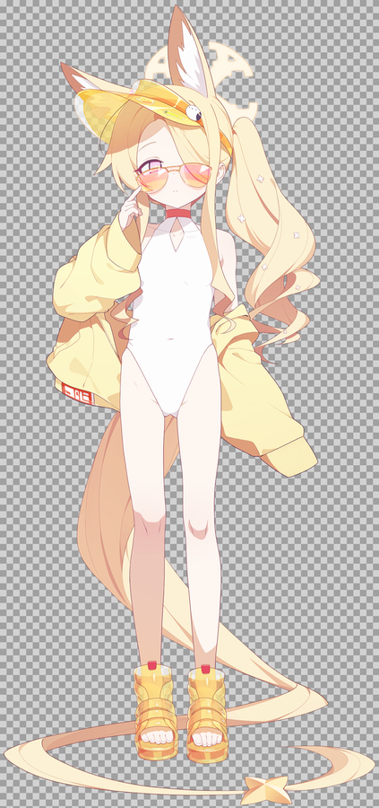
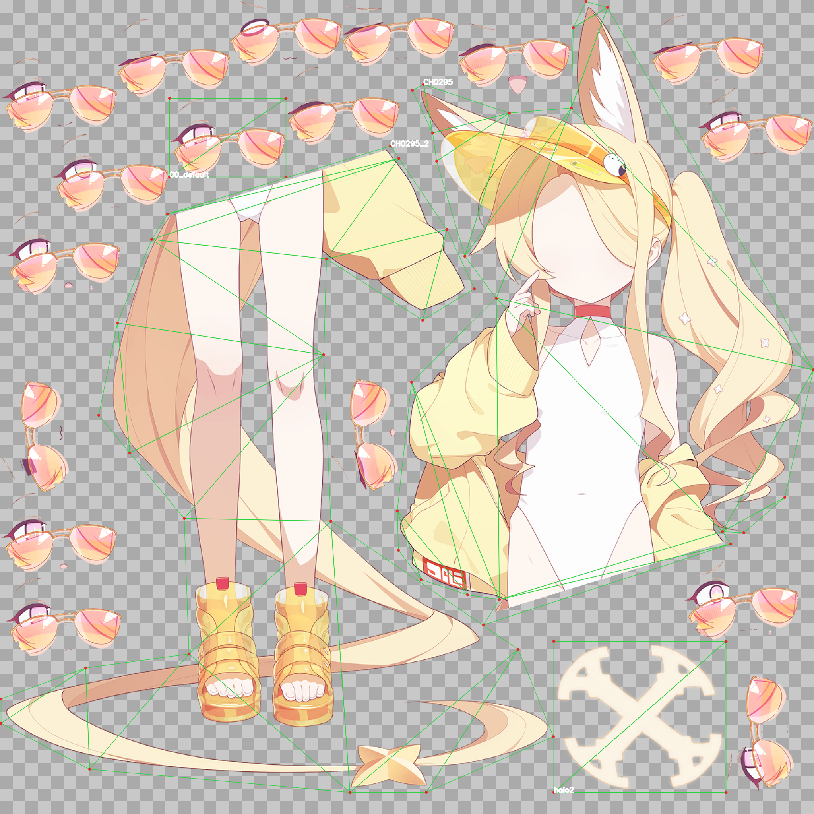

# BA立绘高清提取：PC图集 + 骨骼mesh三角面

从日服PC客户端取2048² / `scale:1.3`的spine图集，用官方spine-core读skel拿到mesh的世界顶点与UV，按三角面从图集采样合成。

示例角色：CH0295圣娅（泳装），动画`Idle_01`的第1.249966507720953 s。

| 成品 | 尺寸 | 说明 |
| --- | --- | --- |
| `out/CH0295_Idle_01_mesh_pc.png` | 1376×2934 | 推荐成品：`Idle_01` @ 1.2499665 s，原生像素 |
| `out/CH0295_setup_mesh_pc.png` | 1376×2935 | setup pose（骨骼静止姿势） |

输出尺寸 = 画布1390×2959裁到内容bbox。

CH0295成品预览：



## 目录

```
build_mesh_pc.py                       三角面合成（核心）
tools/spine_probe/dump_official.mjs    官方 spine-core 读 skel -> pose JSON
tools/spine_probe/node_modules/        @esotericsoftware/spine-core 4.2.120（不入库，`npm i` 复原）
tools/spine_probe/official_pc*.json    本例 pose（setup / Idle_01@1.2499665）
tools/extract_portrait.py              从客户端 bundle 导出素材（跨平台，换角色时用）
spine_src/ch0295_spr/                  本例素材：CH0295_spr.atlas / .skel / .png(2048²)
out/  mesh_out/                        成品 / 诊断图
.gitignore                             忽略 node_modules、临时提取目录、超分产物等
```

## 依赖

- Python 3.12 + numpy / opencv / Pillow
- Node 18+ + `@esotericsoftware/spine-core@4.2.120`
- AssetStudioModCLI（仅提取素材时需要，Windows跑`.exe`；Linux/macOS跑`.dll` + dotnet，用`--cli`指定）

## 代码流程

1. `python tools/extract_portrait.py --char <角色代号>` → 素材落在`spine_src/<角色代号>/`（顺带打印动画名；也可`--out-dir` / `--pose-dir` / `--cli` / `--game-dir`覆盖）。
2. `node tools\spine_probe\dump_official.mjs <atlas> <skel> tools\spine_probe\pose.json <动画> <秒>`—— 动画名从第1步的打印里挑；秒数决定取哪一帧（任意时刻，或直接用setup pose）。
3. `python build_mesh_pc.py --atlas <atlas> --png <png> --pose <pose.json> --out <png>`—— 画布尺寸、缩放、z序全从atlas/skel里读，不需要改代码。

## 流程详解

### 1. 素材

换角色时才需要（本例素材已在`spine_src/ch0295_spr/`，重新导出一遍是byte级相同的）：

```powershell
python tools/extract_portrait.py --char ch0295_spr    # 加 --find 只列 bundle，不导出
```

- `--char`就是bundle名里的那个代号（`spinecharacters-<代号>-`），**原样精确匹配**：`ch0295_spr` / `airi_spr` / `np0001_spr` / `aris_noweapon_spr`… 不确定代号就`--list-codes`（当前客户端共666个）。
- **代号 → 角色**：`--list-codes`只给代号、不给角色名。想看某个学生 / 某套换装对应哪个代号，走[ba-student-crafting-favor](https://github.com/m0okra/ba-student-crafting-favor)里那套流程——从[SchaleDB](https://schaledb.com)的`students.min.json`按名字查到条目，取它的`DevName`（`CH0273`这类）和`PathName`（`mari_idol`这类），再回来对bundle名里的`spinecharacters-<代号>-`。
- 立绘包名形如`assets-_mx-spinecharacters-<代号>-_mxdependency-{textures,textassets,assets,materials}-*.bundle`；剧情NPC只有`-<代号>-_mxprolog-*`（如`chinatsu_spr` / `arona_spr`），一样能导出。
- 素材统一落在`spine_src/<代号>/`（本例`spine_src/ch0295_spr/`）。
- 注意不要拿成其他素材，`ch0295_home`是记忆大厅Live2D，`cafe-characteranimation-ch0295`是小人。
- 客户端目录只读（有XIGNCODE），脚本只读它、把bundle拷到`out/bundles/`再解析（导出完自动清）。
- 客户端位置：`--game-dir` > 环境变量`BA_GAME_DIR` > 本机常见安装位置（Linux下会试Steam/Proton的`steamapps/common/BlueArchive`）；也可以直接给`AssetBundles`目录。
- 导出脚本会顺手用`dump_official.mjs`读一遍，验证atlas/skel可用并打印全部动画名。

### 2. 导出pose（关键一步）

```powershell
# 动画帧：文件名就能看出是哪个动画、哪一秒
node tools\spine_probe\dump_official.mjs spine_src/ch0295_spr/CH0295_spr.atlas `
     spine_src/ch0295_spr/CH0295_spr.skel tools/spine_probe/official_pc_idle125.json Idle_01 1.249966507720953

# setup pose：不加 anim / time
node tools\spine_probe\dump_official.mjs spine_src/ch0295_spr/CH0295_spr.atlas `
     spine_src/ch0295_spr/CH0295_spr.skel tools/spine_probe/official_pc.json
```

脚本会打印每个attachment的顶点数、三角形数、`weighted`标记，以及**page px / rig unit**的x、y两个比例 —— 两者都必须等于atlas的`scale`（本例1.3003 / 1.3001），不等就是UV错了。

pose JSON里已经是**世界顶点 + page UV**（不需要Python端再装spine运行时），所以`official_pc*.json`直接入库：没有Node也能跑到第2步。

加载链**必须**是`TextureAtlas` → `AtlasAttachmentLoader` → `SkeletonBinary`，原因见坑1。

### 3. 合成

```powershell
python build_mesh_pc.py --pose tools/spine_probe/official_pc_idle125.json `
                        --out out/CH0295_Idle_01_mesh_pc.png
```

正常输出：

```
atlas 2048x2048  canvas 1390x2959  pose Idle_01@1.249967s  scale 1.3
rig->canvas 1.30031, 1.30011 px/unit  origin (-504.78, 1420.96)
halo        halo           Region verts  4 tris  2  canvas x 521..954 y 143..523  ...
CH0295_2    CH0295_2       Mesh   verts 23 tris 21  canvas x 0..1390 y 1336..2962  图框内三角面外还有 447432 px alpha (max 255，邻家sprite/留白，正常)
CH0295      CH0295         Mesh   verts 23 tris 21  canvas x 162..1209 y 3..1570    图框内三角面外还有 140736 px alpha (max 255，邻家sprite/留白，正常)
00_default 00_default      Region verts  4 tris  2  canvas x 485..779 y 519..717   ...
saved out/CH0295_Idle_01_mesh_pc.png (1376, 2934)
```

内部做的四件事：

1. **画布**：`canvas_px = reference_resolution × page_scale`（本例`1068.974×2275.954 × 1.3` → 1390×2959）。
2. **逐顶点**：`canvas = ((world_x - data.x) * K, (data.y + data.height - world_y) * K)`，`K = canvas_w / data.width`。
3. **逐三角面**：3个角点在page px与canvas px各有一对坐标 → 三角内重心插值出每个像素的UV，一次性`cv2.remap`采样（不是逐三角贴图，所以共享边不会被混合两次）。
4. **合成**：每个attachment采样后先乘上它的slot颜色（`slotColor`的rgb与alpha），再按draw order以预乘alpha叠（每个attachment用它自己的`blend`：normal走over、additive直接相加、multiply、screen），最后还原直通alpha；默认裁到bbox。

`mesh_out/`会写两张诊断图：`*_preview.png`（垫棋盘格）、`*_page_overlay.png`（三角面画在图集页上）。

三角面叠图（`*_page_overlay.png`）：



## 注意事项

1. **UV必须走`TextureAtlasRegion`那条分支**。spine-core 4.2的`MeshAttachment.updateRegion()`里，只有`region instanceof TextureAtlasRegion`才用`offsetX / originalWidth`把UV展开到**未裁剪的原始图框**（游戏里的mesh UV就是按原图归一化的）；否则走`else`，把UV当成裁剪矩形内的0..1。两者差一个缩放加平移。手搓`{u,v,u2,v2}`的region stub字段看着全对，加载会静默掉进`else`，网格贴到错误的像素上 —— 所以必须`new TextureAtlas(text)` + `new AtlasAttachmentLoader(atlas)` + `new SkeletonBinary(loader)`。顺带好处：atlas里`rotate:90/180`也由官方`updateRegion()`处理。
2. **mesh不是贴轮廓的紧包**。本例身体件只有23个顶点，会把轮廓外的透明区和图框留白一起盖住。所以三角面外还有大量sprite alpha是**正常**的。
3. **同一片像素被多个region共用**。图集里每个表情、其它变体的sprite就落在身体矩形内，靠mesh天然排除，不需要事后清洗。
4. **z序 = 骨骼draw order**：光环在最底（被耳朵、头发遮住）→ 下半身 → 上半身 → 脸在最上。
5. **图集透明像素是黑的**。采样/缩放要走预乘alpha，否则边缘会被透明黑压灰；`build_mesh_pc.py`里已经这么做了。
6. **`.atlas`的`offsets`只能用于同一画布内的相对定位**（上下半身之间的相对位置精确到像素），不能各自独立定位后再拼 —— 会出缝。
7. **客户端目录只读**。有XIGNCODE，改文件会触发异常客户端。
8. **slot颜色（`slotColor`的rgb与alpha）要乘进采样结果**。BA用它控制配件强度：同一角色挂多件光环 / 表情层时靠它的alpha淡出（常见到0.0x量级），不乘就会把本该只叠一层的加色件按满强度画上去。
9. **本脚本的边界**：只支持单atlas page；不做蒙版 / 描边 / tint（slot颜色除外）。四种`blend`（normal/additive/multiply/screen）都按预乘形式实现，遇到未知值会在stdout打印警告并按normal处理。

## 实测数据（本例）

| 项 | 值 |
| --- | --- |
| 图集 / scale / 画布 | 2048² / 1.3 / 1390×2959 |
| 合成耗时 | 1.3 s（含读2048² 图集） |
| 成品与原图 | page→canvas缩放1.0003，即直接取图集像素，无重采样损失 |
